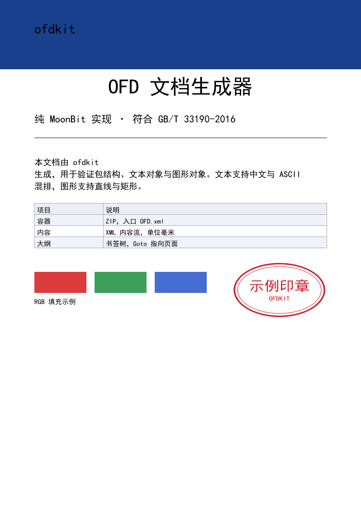
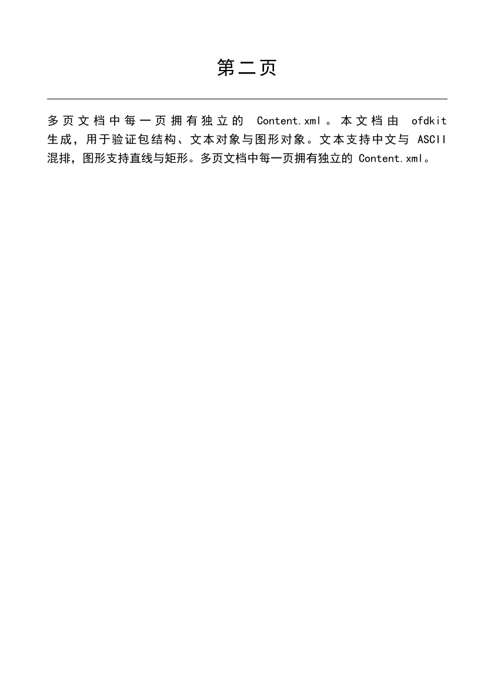

# ofdkit

纯 MoonBit 实现的 **OFD 文档生成器与结构校验器**。

OFD（Open Fixed-layout Document，开放式版式文档）是国家标准 **GB/T 33190-2016** 定义的版式文档格式，在电子发票、电子档案、电子证照等场景中作为 PDF 的国产替代格式使用。ofdkit 让 MoonBit 程序可以直接生成 `.ofd` 文件，并用独立的解析路径校验自己产出的包结构。

```
业务数据  →  ofdkit  →  xxx.ofd  →  OFD 阅读器
```

 

<sub>上面两页由 `ofdkit demo` 生成，嵌入黑体子集与一张 PNG 印章；用仓库内的 `scripts/preview_ofd.py` 从生成的 `.ofd` 直接渲染出来。</sub>

## 现在能做什么

- 生成符合标准包结构的 `.ofd` 文件（ZIP 容器 + `OFD.xml` 入口 + `Doc_0/Document.xml` + 每页 `Content.xml`）
- 多页文档，A4 或自定义页面尺寸
- 文本对象：中文与 ASCII 混排、字号、颜色
- 图形对象：直线、矩形、填充矩形、自定义路径（`M` / `L` / `C` / `Q` / `B` 指令）
- **TrueType 字体嵌入与子集化**：给一个字库文件和使用到的文本，ofdkit 只保留需要的中文字形并重编号，把 9.7 MB 的黑体压到 21 KB（110 个字形），hinting 表完整保留
- **基于真实字形的文本度量与自动换行**：有嵌入字体时按字体的 advance width 排版，宽度与 FreeType 逐位一致
- **图片对象**：PNG / JPEG 原样打包进 `DocumentRes.xml`，按毫米框定位（印章、logo 这类）
- **ZIP 压缩**：自研 DEFLATE 编码器（固定 Huffman + 哈希链 + 惰性匹配），可压缩条目**按压缩存储**、不可压缩的自动退回 store；示例包 51 KB → 34 KB
- **表格**：`page.table()` 画网格，表头底色、**斑马纹**、**边框颜色**、内边距均可配置，单元格超宽按字符截断补省略号
- **段落排版**：`page.paragraph_aligned()` 支持左/中/右/**两端对齐**；两端对齐按中文规范分配字间距，且不会把 `Content.xml` 这类拉丁词拉开
- **字间距**：`page.text_spaced()` 逐字定位，`page.text_justified()` 按框宽撑满
- **文档大纲**：`doc.add_outline()` 写入阅读器的书签树，支持层级
- 文档元数据：标题、作者、主题、关键词、创建日期
- 结构自校验：`ofdkit verify` 会重新解析生成的包，16 项检查覆盖必需文件、引用、对象 ID 上限、字体可解析性、图片格式、大纲目标
- **跨平台码点**：`cmap` 同时写 format 4（BMP）与 format 12（增补平面），生僻字与 emoji 也能进子集

## 现在不能做什么

这些是已知缺口，不是"暂未测试"——代码里确实没有：

- **不读取、不渲染 OFD**。这是生成侧工具，没有版面解析和栅格化能力。
- **不支持签章**。GB/T 38540 的电子签章（`Signatures.xml` / `Seal.esl` / `SignedValue.dat`）尚未实现；它需要 SM2、ASN.1 DER 与国密证书链，工作量约等于现有全部功能之和，且没有证书就无法验证。
- **不支持 OpenType 高级排版**。`GSUB`/`GPOS` 不读也不用，竖排、连字、字距调整表都不生效；子集字体里只带 `glyf`/`loca`/`hmtx`/`cmap` 与 hinting。
- **不支持渐变、透明度、裁剪路径**。图形只有纯色描边与填充，`CGTransform` 与 `Clip` 未实现。
- **压缩用固定 Huffman 单块**：比 zlib `-9` 大约差 6%~14%（示例包 32.5 KB vs 30.2 KB）。动态 Huffman 需要码长树构建与传输，收益不足以抵消复杂度。
- **位图只认 PNG / JPEG**。JBIG2、CCITT G4、JPEG 2000 这类 OFD 允许的格式没有写入口。

## 安装

```
moon add BenPaoBaMingWangXing/ofdkit
```

要求 MoonBit 工具链 `moon >= 0.1.20261023`。

## 快速开始

```mbt
fn build_report() -> Bytes {
  let doc = @ofdkit.Document::new()
    .set_title("月度报表")
    .set_author("财务部")
  let page = doc.add_page()          // A4, 210 x 297 mm
  page.text(20.0, 30.0, 10.0, "月度报表")
  page.line(20.0, 38.0, 190.0, 38.0, 0.4)
  page.text(20.0, 50.0, 5.0, "本期收入较上期增长 12.4%。")
  page.fill_rect(20.0, 60.0, 40.0, 8.0, @ofdkit.Color::new(24, 64, 140))
  doc.to_bytes()
}
```

坐标单位统一为**毫米**，原点在页面左上角，Y 轴向下——与标准一致，调用方不需要做任何单位换算。

### 嵌入中文字体

```mbt
let font_bytes = @fs.read_file_to_bytes("C:/Windows/Fonts/simhei.ttf")
// 子集只覆盖这段文本里出现的字符。
ignore(doc.embed_font_for_text("SimHei", font_bytes, "月度报表 本期收入 12.4%"))
let page = doc.add_page()   // 新页面自动使用刚注册的字体
page.text(20.0, 30.0, 10.0, "月度报表")
```

`embed_font_for_text` 会解析 TrueType、按文本取字符集、做复合字形闭包、重建 `glyf`/`loca`，然后把子集注册到 `PublicRes.xml` 的 `FontFile` 下。之后 `add_page` 创建的页面默认就用这个字体。

## 命令行

```
moon run cmd/main -- demo      out/demo.ofd
moon run cmd/main -- demo      out/demo-font.ofd C:/Windows/Fonts/simhei.ttf
moon run cmd/main -- verify    out/demo.ofd
moon run cmd/main -- info      out/demo.ofd
moon run cmd/main -- font-info C:/Windows/Fonts/simhei.ttf
```

`verify` 的实际输出（带嵌入字体时）：

```
校验 out/demo.ofd
  通过  zip container parses  (13 entries)
  通过  OFD.xml present  (at archive root)
  通过  OFD.xml declares ofd:OFD
  通过  DocRoot declared  (Doc_0/Document.xml)
  通过  DocRoot resolves  (Doc_0/Document.xml)
  通过  Document.xml declares ofd:Document
  通过  document declares a page box  (0 0 210 297)
  通过  document has pages  (2 page(s))
  通过  every page content stream exists
  通过  outline destinations resolve  (2 entr(ies))
  通过  PublicRes resolves  (Doc_0/PublicRes.xml)
  通过  declared font files are packaged  (1 font file(s))
  通过  embedded fonts are readable  (Font_1.ttf: 110 glyphs)
  通过  DocumentRes resolves  (Doc_0/DocumentRes.xml)
  通过  declared images are packaged  (1 image(s))
  通过  images are PNG or JPEG  (1 image(s))

16/16 checks passed
```

## 包结构

```
OFD.xml                         入口，指向 DocRoot
Doc_0/Document.xml              文档骨架、页面列表、共享资源引用
Doc_0/PublicRes.xml             字体等共享资源
Doc_0/Pages/Page_0/Content.xml  第 1 页内容流
Doc_0/Res/Font_1.ttf            子集化后的嵌入字体
```

内容流里的对象形如：

```xml
<ofd:TextObject ID="1000" Boundary="20 30 60 6" Font="1" Size="5" Fill="true">
  <ofd:FillColor Value="0 0 0"/>
  <ofd:TextCode X="0" Y="5">月度报表</ofd:TextCode>
</ofd:TextObject>
```

## ZIP 压缩

包里 97% 的字节是 XML 和字体子集，两者都高度可压缩，所以写入侧带了一个自研的 DEFLATE 编码器（RFC 1951）：

- **单块固定 Huffman**。不构建码长树，省掉码表传输，代价是压缩率比动态 Huffman 差一点。
- **哈希链 + 惰性匹配**。每个三字节前缀挂在一条链上，最多回看 48 个候选；若下一位置能匹配得更长，当前字节就退化成字面量。这一步让 XML 的压缩率从 zlib 的 72% 拉到 96%。
- **不划算就退回 store**。小于 64 字节、或者压缩后反而更长（比如已经压过的 PNG）的条目原样存储。示例包里的 `Image_2.png` 就是这么处理的。

实测（示例包，含字体与图片）：

| 条目 | 原始 | 压缩后 | zlib `-9` |
|---|---|---|---|
| `Page_0/Content.xml` | 7,999 | 1,260 | 1,178 |
| `Page_1/Content.xml` | 5,387 | 1,177 | 1,074 |
| `Font_1.ttf` | 21,536 | 14,583 | 12,706 |
| `Image_2.png` | 14,351 | 14,351（store） | 14,142 |
| 整包 | 51,467 | **32,512** | 30,159 |

XML 只差 6%，字体差 14%：字形轮廓的字节分布很平，固定 Huffman 无法按频率自适应。整体差 6%，换来零依赖。

解码侧同样是自己写的（只覆盖 store 与固定 Huffman），用在 `verify` 的独立读取路径上——写入与校验共用同一张距离码表，任何一侧写错都会在测试里炸掉。

## 字体子集化做了什么

一个中文字库动辄 10 MB、两万多个字形，直接塞进文档不现实。ofdkit 的取舍是：

1. **字形重编号**。保留下来的字形被压进 `0..n-1`，`loca`、`hmtx`、`maxp` 都按新数量重写——这是体积从百 KB 掉到十几 KB 的关键。
2. **复合字形闭包并重写组件索引**。汉字里"汉""湖"这类由部件拼出来的字形引用了其他字形，必须递归收进来；重编号后还要把组件里的 glyph id 一并改掉，否则部件会指向空位。
3. **重建 `cmap`**。只保留文档用到的码点，按连续区间合并成 format 4 段，几千字的表压到几十字节。
4. **`loca` 用短格式**（offset/2），能省一半。
5. **`post` 重写成 version 3**（无字形名），32 字节。

实测：`simhei.ttf` 9,753,388 字节 / 28,562 字形 → **21,536 字节 / 110 个字形**，示例文档里 104 个不同字符全部覆盖。多出的 1 KB 是 hinting 三张表（`cvt `/`fpgm`/`prep`）——留着它，小字号才不会被渲染器“自作主张”地重新对齐。

验证分两层：把子集从包里取出来交给 FreeType 真实渲染，先看"有没有缺字"，再用二值化墨迹的 IoU 与原字体对齐——保留 hinting 之后，字号 160 / 40 / 20 的 IoU 都是 **1.0000**，逐像素一致。

## 表格与对齐

报表里最常画的其实是表格。`TableStyle` 只需要列宽，行数从数据推出来：

```mbt
let style = @ofdkit.TableStyle::new(20.0, 118.0, [40.0, 130.0])
let bottom = page.table(style, [
  ["项目", "说明"],
  ["容器", "ZIP，入口 OFD.xml"],
  ["内容", "XML 内容流，单位毫米"],
])
```

默认 6.5 mm 行高、4.2 pt 字号、0.2 mm 细线、表头浅灰底。单元格文字在列宽内放不下时按字符截断并补省略号——报表里一个盖住邻格的单元格，比一个老实承认被截断的更糟。

样式都是链式改的，不需要构造第二个结构体：

```mbt
let style = @ofdkit.TableStyle::new(20.0, 118.0, [40.0, 130.0])
  .with_zebra(@ofdkit.Color::new(246, 248, 252))      // 隔行浅底
  .with_border_color(@ofdkit.Color::new(150, 160, 180)) // 灰线而不是印刷黑
  .with_row_height(7.0)
  .with_padding(2.0)
```

表格超过一页时用 `table_across_pages`，它会自动加页并在每页重复表头：

```mbt
let (last_page, next_y) = doc.table_across_pages(page, style, rows)
```

A4、20 mm 页边距、6.5 mm 行高时，每页容纳 38 行正文加表头。

对齐是同一套度量的直接应用：

```mbt
page.text_aligned(20.0, 52.0, 170.0, 12.0, @ofdkit.Center, "标题")
```

两端对齐按中文排版习惯处理：把富余量均摊到**字与字之间**，而不是像西文那样全部塞进空格；同时不会在两个 ASCII 字符之间开口，所以 `Content.xml` 不会被拆开。最后一行保持左对齐，这是段落排版的通行做法。

```mbt
// 段落两端对齐：除最后一行外每行都撑满 170 mm
page.paragraph_aligned(20.0, 52.0, 170.0, 5.0, 8.0, @ofdkit.Justify, text)
// 单行两端对齐
page.text_justified(20.0, 90.0, 170.0, 5.0, "这一行会被撑满")
```

字间距走 `text_spaced`，负值收字。它把每个字符写成独立的 `TextCode` 并给出各自的 X 坐标，任何阅读器都按坐标摆放，不依赖 `DeltaX` 的解析差异：

```mbt
page.text_spaced(20.0, 30.0, 8.0, 1.0, "字 间 距")   // 每字后加 1 mm
```

## 文档大纲

长文档需要书签。`add_outline` 接受目标页面和层级：

```mbt
let cover = doc.add_page()
let chapter = doc.add_page()
doc.add_outline("封面", cover, 1)
doc.add_outline("第一章", chapter, 1)
doc.add_outline("1.1 背景", chapter, 2)
```

写进 `Document.xml` 的 `Outlines`，每项是一个 `Goto` 动作加页面 ID。校验器会确认每个目标都指向真实存在的页面——大纲指错页是阅读器里最难发现的一类坏链接。

## 文本度量

有嵌入字体时，`page.measure_text()` 走的是字体自己的 `hmtx`：把所有字符的 advance width 加起来，除以 `unitsPerEm` 再乘字号。没有嵌入字体时退化为"中文一字宽、ASCII 半字宽"的估算，只用来撑开包围盒。

一致性用 FreeType 对表（字号 100，单位与像素同量纲）：

| 文本 | ofdkit | FreeType |
|---|---|---|
| `OFD 文档生成器` | 700 | 700.0 |
| `中文` | 200 | 200.0 |
| `ABCabc123` | 450 | 450.0 |

自动换行基于同一套度量：

```mbt
// 在 x=20，宽 170mm 的栏内排版，行高 8mm；返回最后一行的下一行 y
let next_y = page.paragraph(20.0, 30.0, 170.0, 5.0, 8.0, "很长的一段中文……")
```

## 与成熟实现的结构对齐

[ofdrw](https://github.com/ofdrw/ofdrw)（OFD Reader & Writer，MIT，是目前使用最广的 OFD 实现）的测试样例 `helloworld.ofd` 被拿来逐项比对包结构。据此修正了两处偏差：

1. **ZIP 必须包含目录条目**（`Doc_0/`、`Doc_0/Pages/`、`Doc_0/Pages/Page_N/`），只写叶子文件是不够的——不少阅读器依赖目录记录遍历包；
2. **`CommonData` 的子元素顺序**为 `PageArea` → `PublicRes` → `MaxUnitID`；页面尺寸在 `Document.xml` 里声明一次，`Content.xml` 不再重复一层 `Area`。

这两处都是"按标准字面写合法"但"与事实实现不一致"的差异，自己的校验器发现不了——只有拿别人的产物对比才会暴露。

## 怎么证明它是对的

五层，都不依赖 ofdkit 自己：

1. **外部 ZIP 解析**：生成的文件用 Python 标准库 `zipfile` 打开，`testzip()` 通过（含 deflate 条目解码），逐个条目 CRC 校验。
2. **外部 XML 解析**：四个 XML 用 `xml.etree.ElementTree` 解析，命名空间为 `http://www.ofdspec.org/2016`，可正确读出页面数、对象数、中文文本。
3. **自带结构校验**：`ofdkit verify` 走独立的 ZIP 读取路径（`parse_zip` → 中央目录 → 本地头 → 数据），不复用写入侧代码。
4. **字体真实渲染**：子集字体交给 FreeType 渲染，检查笔画完整，并与原字体做墨迹 IoU 比对。
5. **第三方阅读器读取**：把包交给 [ofdrw](https://github.com/ofdrw/ofdrw)（Java，MIT，目前使用最广的 OFD 实现）解析，核对页面数、对象数、页面尺寸与中文内容。示例包读到 2 页、19 个文本对象（展开为 90 个 `TextCode`，说明逐字定位的写法它认得）、17 个图形对象、1 个图片对象。脚本在 `scripts/java/ReadOfd.java`，方法见 `scripts/reader_check.md`。

第 5 层是唯一能证明"别人真的能读"的证据：前四层都由我这一侧的假设驱动，ofdrw 不是。

这套组合在开发中真实抓到过三个 bug：

- `MaxUnitID` 取的是文档计数器，而页面对象 ID 是分段分配的，声明值小于实际对象 ID；
- `FontFile` 是元素文本，校验器却按属性去匹配，导致"缺字体文件"一直是盲的；
- 子集字体最初写成小端（那是 ZIP 的约定，TrueType 是大端），FreeType 直接拒绝加载。

## 设计取舍

- **不引入 XML 库**：OFD 的 XML 结构浅且固定，手写发射器比通用 DOM 更可控，也便于保证转义不漏。
- **不引入 ZIP 库**：容器逻辑只有几百行，自己写换来零依赖和字节级可复现（时间戳固定为 ZIP 纪元）。
- **不引入字体库**：只需要读表、取字形、重建两个表，自己写比绑定 FreeType 更轻，也不必处理跨平台二进制依赖。
- **不引入压缩库**：DEFLATE 只写一种块类型（固定 Huffman），编码器 160 行、解码器 150 行。压缩率比 zlib 差一截，但换来零依赖与"能读懂自己写出的每一个 bit"——自校验的 inflate 与写入侧共用同一张距离码表，任何一方写错都会在测试里立刻暴露。
- **写入与校验代码分离**：校验器读自己的输出，但走完全不同的代码路径，避免"用同一个 bug 验证自己"。
- **对象 ID 分段**：每页从 `page_id * 1000` 起分配，避免页间冲突，也便于人工排查。

## 测试

```
moon test
```

91 个测试，覆盖 CRC-32 标准向量、ZIP 结构、DEFLATE 往返、XML 转义、序列化输出、包校验、TrueType 表目录解析、子集化错误路径、文本度量与换行、表格几何、对齐与两端对齐、字间距、图片格式嗅探、大纲目标解析、跨页分页，以及若干负例（截断归档、缺页面流、字体文件不是字体、图片魔数不对）。

## 路线图

- [ ] GB/T 38540 电子签章（需要 SM2 与国密证书）
- [ ] 渐变与透明度填充

## 文档

- [项目申报书](docs/PROPOSAL.md)：基本信息、核心功能范围、本期不包含的功能、验收判据、与参考实现的一致性验证
- [开发历程](docs/DEVLOG.md)：选题查重、三个真实 bug 的来龙去脉、AI 工具怎么用、对 ofdrw 与 FreeType 的借鉴
- [CHANGELOG](CHANGELOG.md)：每个版本改了什么

## 许可证

Apache-2.0，见 [LICENSE](LICENSE)。第三方归属见 [NOTICE](NOTICE)。
